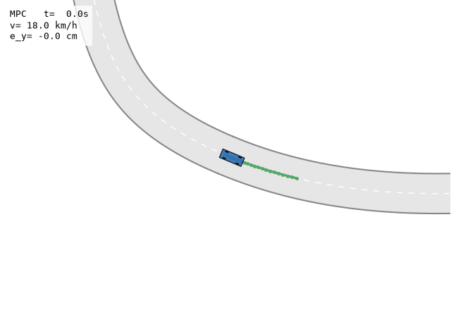
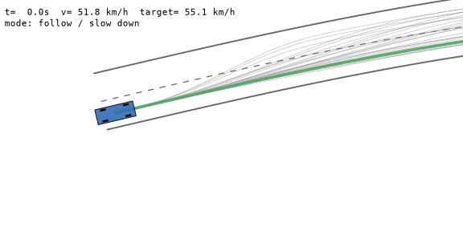
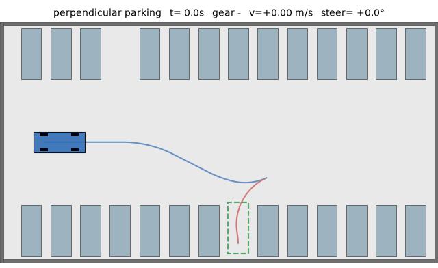
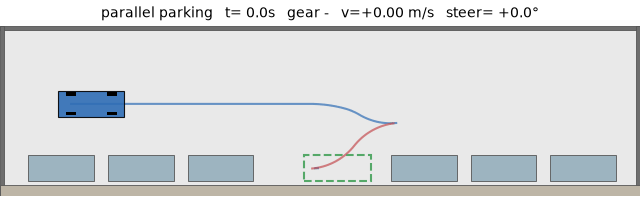
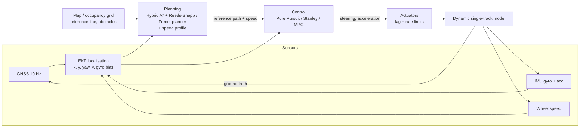
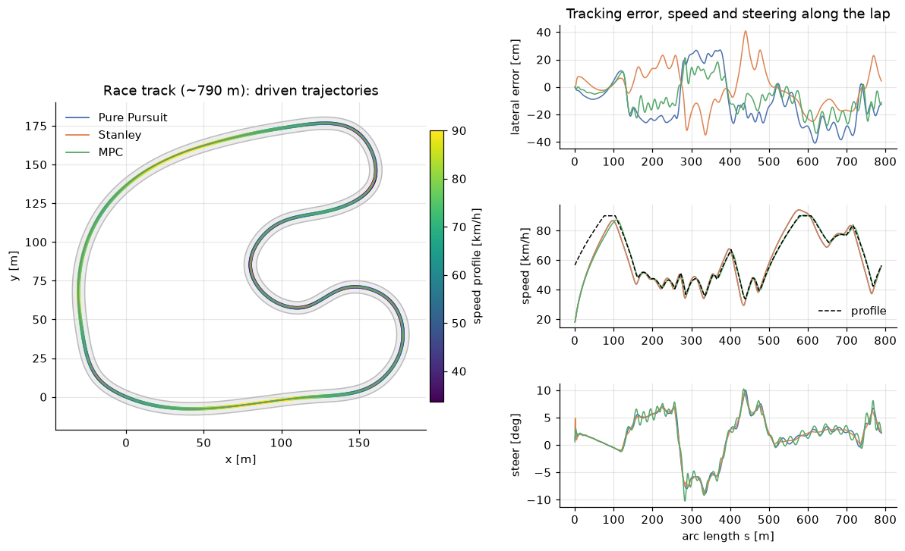
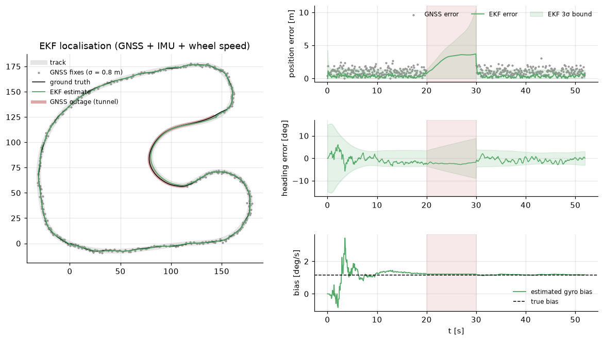
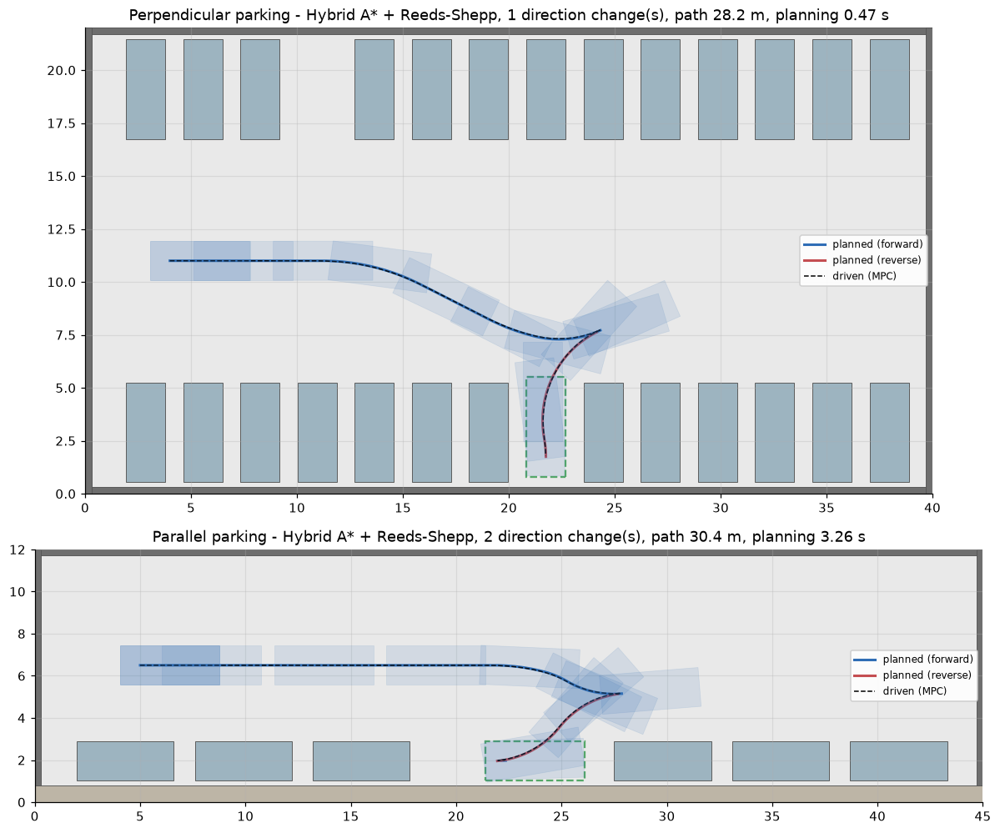
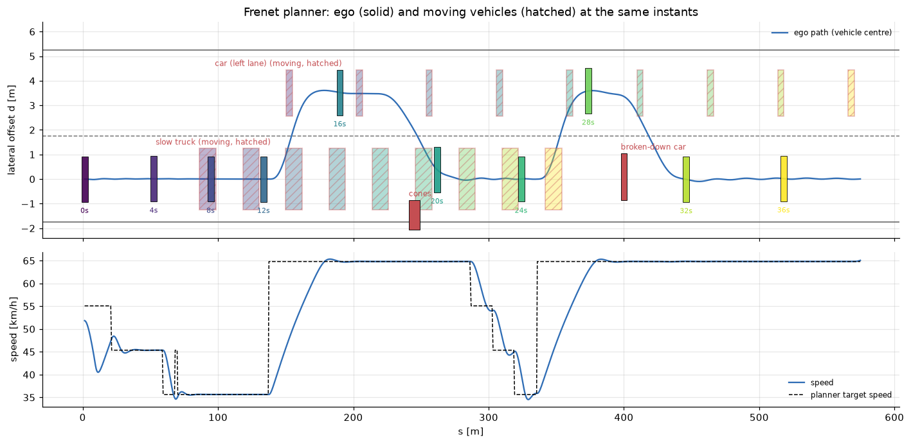

# Autonomous Driving Stack in Python


A compact but complete **autonomous driving software stack** for a passenger car, written from scratch in Python
(NumPy / SciPy / OSQP, no robotics frameworks). It covers the full chain **localisation → planning → control → vehicle**,
runs every module in closed loop against a dynamic vehicle model and benchmarks the alternatives against each other.

| Race track – MPC with prediction horizon | Overtaking & obstacle avoidance – Frenet planner |
|:---:|:---:|
|  |  |
| **Perpendicular parking – Hybrid A\* + MPC** | **Parallel parking – Hybrid A\* + MPC** |
|  |  |

New to the topic? [`docs/CODE_WALKTHROUGH.md`](docs/CODE_WALKTHROUGH.md) explains every module and the code step by step.

## What is inside

| Module | Content |
|---|---|
| **Vehicle** (`adstack/vehicle`) | Kinematic and dynamic single-track (bicycle) model with linear tyres, steering actuator (lag + rate limit), powertrain lag, saturations, RK4 integration |
| **Localisation** (`adstack/localization`) | Simulated GNSS (10 Hz, σ = 0.8 m, outages), IMU with gyro bias, wheel speed; **Extended Kalman Filter** estimating pose, speed and gyro bias |
| **Global / manoeuvre planning** (`adstack/planning`) | Cubic-spline reference paths with Frenet projection, curvature/acceleration-limited speed profiles, grid **A\***, **Hybrid A\*** with **Reeds-Shepp** analytic expansion for parking |
| **Local planning** | Sampling-based **Frenet planner** (quintic lateral profiles × target speeds) with prediction of moving obstacles, keep-right rule, proximity cost and emergency fallback |
| **Control** (`adstack/control`) | **Pure Pursuit**, **Stanley** (with curvature feed-forward and yaw damping), **LTV-MPC** (combined lateral + longitudinal, sparse QP solved with OSQP in ~3 ms) |
| **Simulation & evaluation** (`adstack/sim`, `adstack/viz`) | Closed-loop simulator, four scenarios, metrics (accuracy, comfort, safety, run time), plots and GIFs |



## Results

All numbers are produced by `python scripts/run_all.py` (tables in [`results/`](results)).

### 1. Path tracking on a race track

790 m circuit with a hairpin, an S-section and fast sweepers; speed profile up to 90 km/h with 5 m/s² lateral
acceleration. The "real" car is the **dynamic** single-track model, while all controllers are designed on the
**kinematic** model, so there is a realistic model mismatch.



| Condition | Controller | RMS lateral error [m] | Max lateral error [m] | Lap time [s] | RMS steer rate [deg/s] | Solve time mean / max [ms] |
|---|---|---|---|---|---|---|
| nominal | Pure Pursuit | 0.202 | 0.410 | 52.5 | 2.75 | < 0.1 |
| nominal | Stanley | 0.157 | 0.409 | 52.1 | 3.04 | < 0.1 |
| nominal | **MPC** | **0.129** | **0.339** | **51.3** | 4.29 | 3.0 / 12.9 |
| EKF in the loop | Pure Pursuit | 0.464 | 1.213 | 52.8 | 21.53 | < 0.1 |
| EKF in the loop | Stanley | **0.370** | **0.967** | 52.5 | 25.86 | < 0.1 |
| EKF in the loop | MPC | 0.435 | 1.147 | 51.8 | 28.91 | 3.2 / 10.5 |
| +25 % mass, −30 % tyre stiffness | Pure Pursuit | 0.372 | 0.966 | 52.9 | 4.89 | < 0.1 |
| +25 % mass, −30 % tyre stiffness | Stanley | **0.192** | **0.621** | 52.5 | 3.43 | < 0.1 |
| +25 % mass, −30 % tyre stiffness | MPC | 0.290 | 0.682 | 51.5 | 7.08 | 3.0 / 28.1 |

**Findings**

- With an accurate state, the **MPC tracks best** and also follows the speed profile most closely (fastest lap),
  because it optimises steering and acceleration jointly and anticipates the next 2 s.
- The MPC is only as good as its prediction model: with a heavier car and less grip the vehicle understeers much
  more than the kinematic model predicts, and the **Stanley controller with yaw-rate feedback becomes more
  robust**. Natural next steps would be a dynamic prediction model or offset-free MPC with a disturbance estimate.
- With the EKF in the loop, the 10 Hz GNSS corrections make the state estimate jump slightly; all controllers react with
  noticeably more steering activity. The MPC, which trusts the state most, is affected the most.
- **Pure Pursuit** needs a sufficient look-ahead distance: with `L_d = 0.1 s · v + 2 m` it became unstable at speed during tuning; `0.15 s · v + 3 m` is used.

### 2. Localisation with a GNSS outage

EKF with state `[x, y, yaw, v, b_gyro]`: IMU yaw rate and acceleration drive the prediction, GNSS position and wheel
speed are the measurements. During the lap the car drives through a 10 s "tunnel" without GNSS.



| Metric | Value |
|---|---|
| GNSS position RMSE | 1.15 m |
| **EKF position RMSE** (outside the outage) | **0.40 m** (≈ 3× better than raw GNSS) |
| Heading RMSE | 1.7° |
| Max position error after 10 s without GNSS (≈150 m dead reckoning) | 3.7 m |
| Estimated gyro bias (true: 1.15 °/s) | 1.18 °/s |
| Mean position NEES (consistent filter: ≈ 2) | 2.3 |

Estimating the gyro bias is what keeps the heading from drifting during the outage. The remaining heading error of
1–2° comes from the side slip of the real car, which the kinematic process model of the filter does not know.

### 3. Automated parking

Hybrid A\* searches over continuous poses with forward and reverse motion primitives, an obstacle-aware Dijkstra
heuristic and a **Reeds-Shepp** shot to the exact goal pose. The path is split at the cusps into forward and reverse
segments; the speed is limited where the curvature jumps (steering-rate limit), and at each cusp the wheels are turned
at standstill before driving off. The MPC tracks the reverse segments with negative speed references.



| Scenario | Planning time | Path length | Direction changes | Final position error | Final heading error | Collision-free |
|---|---|---|---|---|---|---|
| Perpendicular (reverse into a 2.7 m slot) | 0.42 s | 28.2 m | 1 | 4.3 cm | 0.95° | yes |
| Parallel (gap of 7.5 m = car length + 2.8 m) | 3.6 s | 30.4 m | 2 | 4.4 cm | 1.67° | yes |

### 4. Overtaking and obstacle avoidance

Two-lane road with a slow truck, cones narrowing the lane, a car in the left lane and a broken-down car. The Frenet
planner re-plans at 5 Hz: lateral quintic profiles to several target offsets and manoeuvre durations are combined with
seven target speeds, checked against the **predicted** positions of all obstacles and scored by comfort (lateral jerk),
keep-right rule, distance to the lane centre, proximity to obstacles, desired speed and consistency with the previous
plan. The plan is re-started from the previous plan (not from the measured state) as long as the car tracks it, which
removes overshoot during lane changes.



| Tracking controller | Collision | Min. clearance | Lane changes | Max lat. acceleration | Max deviation from plan |
|---|---|---|---|---|---|
| Pure Pursuit | no | 1.19 m | 4 | 4.14 m/s² | 0.25 m |
| Stanley | no | 1.23 m | 4 | 3.06 m/s² | 0.13 m |
| MPC | no | 1.16 m | 4 | 3.75 m/s² | 0.15 m |

The car follows the truck until the gap in the left lane is large enough, overtakes and returns to the right lane
(keep-right). Before the broken-down car it has to slow down because the left lane is occupied by a slower car; it
merges behind that car at a matching speed, passes the obstacle and returns to the right lane.

## Methods in brief

**Dynamic single-track model** (state at the centre of gravity, linear tyres):

$$\dot v_y = \frac{F_{yf}\cos\delta + F_{yr}}{m} - r\,v_x,\qquad \dot r = \frac{l_f F_{yf}\cos\delta - l_r F_{yr}}{I_z},\qquad F_{yi} = -C_i\,\alpha_i$$

verified against the steady-state yaw rate of linear single-track theory, $r = v\,\delta / (L + K_{us} v^2)$, in the tests.

**LTV-MPC**: kinematic bicycle model $x = [X, Y, \psi, v]$, $u = [a, \delta]$, linearised along the previous optimal
trajectory in every cycle, horizon 20 × 0.1 s:

$$\min \sum_{k} \lVert x_k - x_k^{ref}\rVert_Q^2 + \lVert u_k - u_k^{ref}\rVert_R^2 + \lVert u_k - u_{k-1}\rVert_{R_d}^2$$

subject to the linearised dynamics, steering/acceleration limits, steering-rate limit and speed limits. The QP has a
fixed sparsity pattern, so OSQP is set up once and then only updated and warm-started (≈ 3 ms per cycle).

**EKF**: prediction with the IMU, updates with GNSS and wheel speed, Joseph-form covariance update, consistency checked
with NEES/NIS.

**Hybrid A\***: 3D search grid (0.5 m × 0.5 m × 7.5°), 5 steering angles × 2 directions, costs for length,
reversing, direction changes and steering; footprint collision check against a distance transform.

**Frenet planner**: $d(s)$ quintic from the current $(d, d', d'')$ to $(d_T, 0, 0)$, combined with constant-acceleration
speed profiles to obtain the time at which each point is reached; collision check against constant-velocity obstacle
predictions in the $(s, d)$ frame.

## Getting started

```bash
git clone https://github.com/noahli472-ai/autonomous-driving-stack.git
cd autonomous-driving-stack
python -m venv .venv && source .venv/bin/activate   # Windows: .venv\Scripts\activate
pip install -r requirements.txt

python scripts/run_all.py              # all scenarios, tables in results/, figures + GIFs in assets/ (~1.5 min)
python scripts/run_all.py --no-gif --only parking avoidance

pip install pytest ruff
pytest                                 # 20 tests, ~20 s
ruff check . && ruff format --check .  # linting and formatting (also run by GitHub Actions)
```

Using the modules directly (also in [`examples/quickstart.py`](examples/quickstart.py)):

```python
from adstack.control import MPC
from adstack.sim import scenarios
from adstack.sim.metrics import tracking_metrics

track = scenarios.racetrack(v_max=25.0)
log = scenarios.run_racetrack(MPC(), track, use_ekf=True)
print(tracking_metrics(log, track))
```

## Project structure

```
adstack/
├── vehicle/models.py          kinematic + dynamic single-track model, actuator dynamics
├── localization/
│   ├── sensors.py             GNSS / IMU / wheel-speed simulation (noise, bias, outages)
│   └── ekf.py                 Extended Kalman Filter
├── planning/
│   ├── path.py                spline reference path, Frenet projection, speed profile
│   ├── grid.py                occupancy grid, distance map, footprint check, A*
│   ├── reeds_shepp.py         Reeds-Shepp curves (CSC, CCC, CCCC, CCSC, CCSCC families)
│   ├── hybrid_astar.py        Hybrid A* for parking
│   └── frenet.py              Frenet local planner with obstacle prediction
├── control/
│   ├── pure_pursuit.py · stanley.py · mpc.py · base.py (speed controller)
├── sim/
│   ├── simulator.py           closed loop: plant → sensors → EKF → controller
│   ├── scenarios.py           race track, parking lots, two-lane road
│   └── metrics.py
└── viz/plots.py               figures and GIF animations
examples/quickstart.py         minimal usage example
scripts/run_all.py             benchmark + asset generation
tests/                         physics, planning, control and scenario tests
docs/CODE_WALKTHROUGH.md       step-by-step explanation of every module
```

## Limitations and possible extensions

- Linear tyre model (no friction limit) – a Pacejka model would allow studies at the handling limit.
- MPC with a kinematic prediction model; a dynamic model or offset-free MPC would improve robustness to understeer.
- Obstacles are predicted with constant velocity along the lane; no interaction-aware prediction.
- Frenet collision checks use rectangles in the $(s, d)$ frame, which is conservative/approximate on tight curves.
- Possible next steps: perception module (e.g. obstacle detection from a simulated LiDAR point cloud), ROS 2 nodes,
  C++ implementation of the MPC for embedded targets.

## References

- R. Rajamani, *Vehicle Dynamics and Control*, Springer, 2012.
- S. Thrun et al., "Stanley: The robot that won the DARPA Grand Challenge", *J. Field Robotics*, 2006.
- R. C. Coulter, "Implementation of the Pure Pursuit Path Tracking Algorithm", CMU-RI-TR-92-01, 1992.
- D. Dolgov et al., "Path Planning for Autonomous Vehicles in Unknown Semi-structured Environments", *IJRR*, 2010.
- J. A. Reeds, L. A. Shepp, "Optimal paths for a car that goes both forwards and backwards", *Pacific J. Math.*, 1990.
- M. Werling et al., "Optimal Trajectory Generation for Dynamic Street Scenarios in a Frenét Frame", *ICRA*, 2010.
- B. Stellato et al., "OSQP: an operator splitting solver for quadratic programs", *Math. Prog. Comp.*, 2020.
- S. Thrun, W. Burgard, D. Fox, *Probabilistic Robotics*, MIT Press, 2005.

## Author and license

Noah Lindner – [github.com/noahli472-ai](https://github.com/noahli472-ai). Released under the [MIT License](LICENSE).
